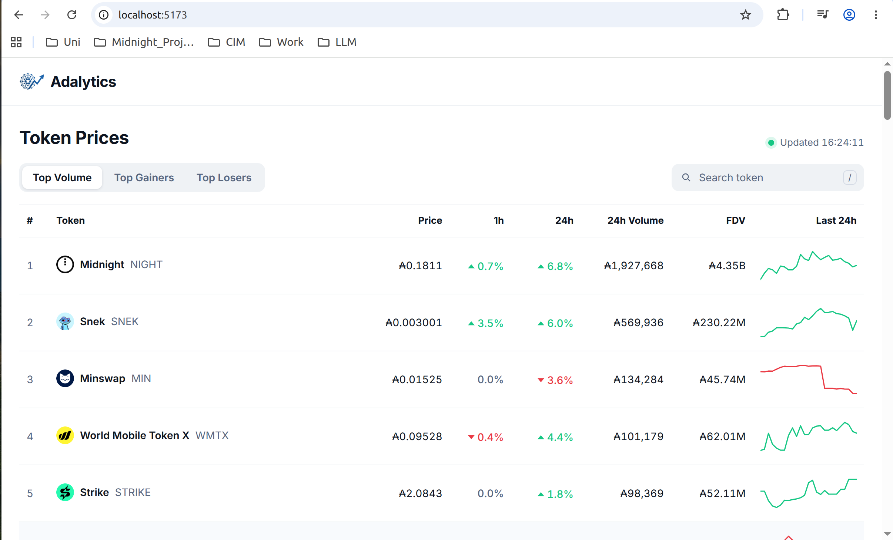
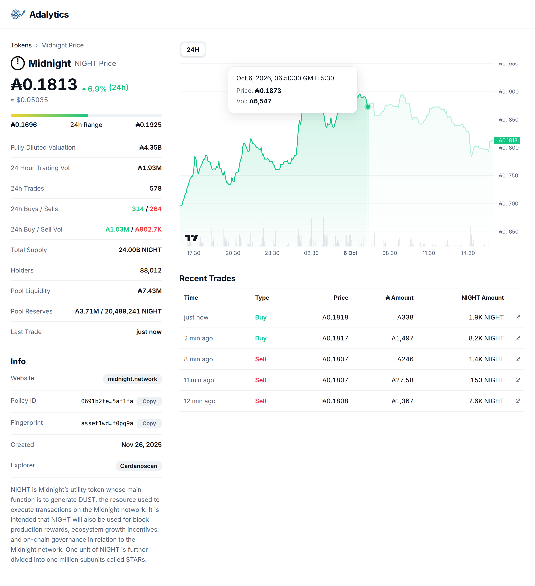
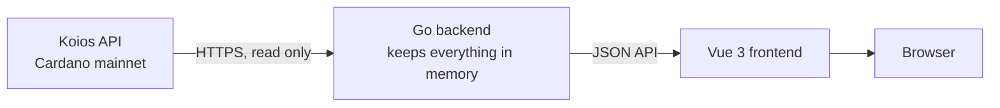
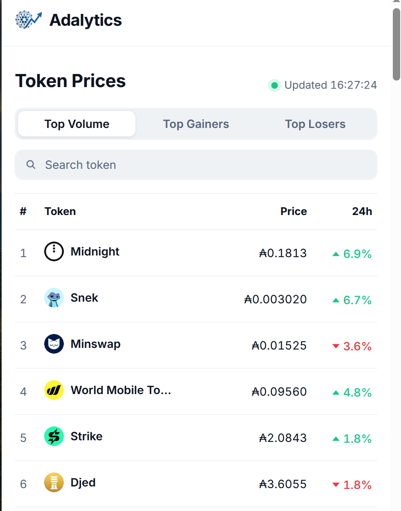

# Adalytics

**Live prices, charts and trades for Cardano tokens, straight from the blockchain.**

Adalytics follows every token that Minswap marks as verified and shows its price, chart and trading activity, like Birdeye or CoinGecko do for other chains. Every number is read from the Cardano blockchain through the [Koios API](https://www.koios.rest): no third-party price feed, no database.



## Features

**Token list**
* Every verified token whose Minswap pool holds at least ₳10,000 (about 75 on a normal day), with price in ADA and US dollars, FDV, 24h volume, trades, liquidity, holders and the 1h, 4h and 24h change
* Top Volume, Gainers and Losers tabs; click any column title to sort by it
* Search by name, ticker or policy ID (press `/`); refreshes by itself every minute

**Token page**
* A live price chart (TradingView Lightweight Charts) with candles from 5 minutes to 1 day, up to 30 days back, volume bars, indicators (MA 20, MA 50, RSI 14, ATR 14), Price / FDV, and a drawing toolbar like Birdeye's: trend lines, rays, horizontal and vertical lines, channels, long and short positions, measuring, brush, arrow, rectangle, text and price labels, with magnet, lock and hide. **See the [chart guide](docs/CHART_GUIDE.md) for what each part means and how to use it.**
* A token panel: price, liquidity, FDV, 5m / 1h / 4h / 24h volume and trades with buys, sells and net, holders, whether the minting policy is locked, price range, links and the project description
* **Trades**: the latest trades with the wallet behind each (Minswap fills many orders in one transaction; Adalytics splits them into one trade per wallet), filter by buys or sells, BIG and WHALE tags for ₳10K and ₳50K+
* **Top Traders**: the 50 wallets that traded the token most in 24 hours, 7 or 30 days. Click a trader to see only its trades and what else it traded

**Large Trades**
* The big trades across every token, up to 30 days back, with filters for token, time, size and wallet. The filters stay in the page address, so a view can be shared

**Everywhere**
* Light and dark mode (the switch at the top right; a first visit follows your computer's setting)
* Works on phones; each browser tab names its page, a token tab shows the live price



## Running it

You need **Go 1.22+**, **Node.js 20+** and a free Koios API token from [koios.rest](https://www.koios.rest) (Profile page).

```bash
# 1. Settings: copy the example and paste your Koios token into .env
cp .env.example .env

# 2. Backend, on http://localhost:8080
cd backend
go test ./...
go build -o adalytics . && ./adalytics

# 3. Frontend, in a second terminal, on http://localhost:5173
cd frontend
npm install
npm test
npm run dev
```

The backend needs about half a minute to load the first data; the site shows a loading box with the progress meanwhile. The last 24 hours are complete a minute or two later, then up to 30 days of history load in the background.

**Settings** (`.env`)

| Setting | Default | What it does |
|---|---|---|
| `KOIOS_API_TOKEN` | (required) | Your Koios token |
| `KOIOS_BASE_URL` | `https://api.koios.rest/api/v1` | The Koios server |
| `PORT` | `8080` | The backend's port |
| `POLL_INTERVAL` | `60s` | How often to check for new trades |
| `HISTORY_DAYS` | `30` | Days of history to load, 1 to 30. Fewer means a lighter startup |
| `KOIOS_PARALLEL` | `8` | Koios requests at the same time when loading history, 1 to 20. Higher loads faster until Koios starts timing out (`504` in the log); then lower it |
| `LOG_LEVEL` | `info` | `debug` shows every Koios request; also `warn`, `error` |

## How it works



**Prices.** Every token on Minswap V2 has a liquidity pool: one output on the blockchain holding ADA on one side and the token on the other. The price is simply

```
price in ADA = ADA in the pool / tokens in the pool
```

**Trades.** Each trade spends the pool output and creates a new one. Comparing one pool state with the next shows what happened: ADA in and tokens out is a **buy**, tokens in and ADA out is a **sell**. A change in the pool's LP tokens is someone adding or removing liquidity, not a trade, and changes under ₳1 are rounding dust.

**US dollars.** Koios has no USD prices, so Adalytics uses the USDM stablecoin's Minswap pool: if 1 USDM costs ₳3.70, then ₳1 is about $0.27.

**At startup** the backend lists every Minswap transaction of the last 24 hours, reads the newest hour (prices, trades), finds the other tokens' pools and loads supply, logos and details. The list opens then; the rest of the 24 hours, the older history and the holder counts (five tokens at a time) load in the background.

**Every minute** it asks Koios which pools were used since the last check and reads only those new trades.

Adalytics is **read only**: it never writes to the blockchain or to disk. Everything is kept in memory and loaded again after a restart.

## Koios usage

It uses the free Koios tier (50,000 requests a day, 100 per 10 seconds) and stays well below it:

| | Measured |
|---|---|
| First 24 hours | about 62 requests |
| 30 days of history | loaded once in the background; the log prints the exact count |
| After that | about 3 requests a minute |
| Memory | about 25 MB with 24 hours loaded, more as older days load |
| CPU | close to 0% between the minute checks |

The backend keeps itself inside the limits: at most 90 requests per 10 seconds, small request bodies, and automatic retries when Koios is busy.

## Watching the backend

Its terminal shows everything it does, one line each:

```
13:20:04 INFO  api     GET  /api/tokens/night/chart            200    4ms   18KB  visitor=203.0.113.7  id=a1f40c
13:21:00 INFO  market  Checked 61 pools: 2 had new swaps
13:21:00 INFO  api     last minute: 37 requests from 3 visitors, 0 errors, 612KB sent, slowest 6ms (GET /api/tokens) | koios: 4 requests, 210KB received, today 3,412 of 50,000 (6.8%)
```

* **api**: every call from the website, with a request ID that is also sent back in the `X-Request-ID` header, so a problem a visitor sees can be found in the log
* **market**: what the tracker is doing; **koios**: every Koios request (with `LOG_LEVEL=debug`; failed or slow ones always show)
* one **summary** line a minute; **WARN** and **ERROR** lines stand out. A crashed request is logged and the server keeps running

## API

| Endpoint | Returns |
|---|---|
| `GET /api/tokens` | Every listed token with price, changes, volume and details, and how much history is loaded |
| `GET /api/tokens/{id}/chart?type=candles&size=1h` | Candles: `size` is 5m, 15m, 30m, 1h, 2h, 4h, 12h or 1D |
| `GET /api/tokens/{id}/chart?range=7D` | Line chart for 24H, 7D or 30D |
| `GET /api/tokens/{id}/trades?limit=10` | Latest trades; with `wallet=stake1…&hours=168`, one wallet's trades in this token |
| `GET /api/tokens/{id}/traders?hours=24&sort=volume` | Top 50 wallets by volume or by net buying (`sort=net`) |
| `GET /api/tokens/{id}/activity` | Change, volume, buys and sells over 5m, 1h, 4h and 24h |
| `GET /api/tokens/{id}/logo` | The token's logo from the Cardano token registry |
| `GET /api/wallets/{stake1…}` | What one wallet traded in the last 24 hours |
| `GET /api/whales?hours=24&min=10000` | Big trades across every token (also `max`, `token`, `wallet`, `offset`) |

## Project structure

```
backend/                 Go: reads Koios, works out prices and trades, serves the API
  main.go                starts the tracker and the web server
  internal/koios/        the Koios client: requests, retries, rate limit
  internal/minswap/      reads a Minswap V2 pool and its price
  internal/market/       prices, trades, history, candles, holders, top traders
  internal/api/          the JSON API, its log and compression
frontend/src/            Vue 3: the website
  pages/                 token list, token page, Large Trades, Page not found
  components/            the parts of each page
  chart/                 indicators and drawing tools for the price chart
docs/                    guides; every file and function in plain words
```

The [code guide](docs/CODE_GUIDE.md) explains how the parts fit together and lists every file. Every function is described in plain words in [backend](docs/BACKEND_FUNCTIONS.md), [market](docs/MARKET_FUNCTIONS.md), [frontend](docs/FRONTEND_FUNCTIONS.md), [chart](docs/CHART_FUNCTIONS.md), [Large Trades](docs/TRADES_FUNCTIONS.md) and [Top Traders](docs/TOP_TRADERS_FUNCTIONS.md).

## Code rules

* **One job per file, at most 200 lines.** A file that grows past that is split by job. (A few older files are still longer and are being split.)
* **Every function has a comment** above it saying what it does, in plain words.
* **Every function is listed in the docs**, with the same words, so the code can be understood without reading it.
* **Tests pass before every push:** `cd backend && go test ./...`, and `cd frontend && npm test && npm run build`.

## Current limits

* Prices come from Minswap V2 only. Tokens that mostly trade elsewhere may show lower volume than sites that combine every exchange, such as DexHunter.
* History is kept in memory, so after every restart it is loaded again from Koios (holder counts too).
* Koios cuts every request off after two minutes, and counting the holders of a very large token (SNEK, MIN, HOSKY) takes 30 seconds to over two minutes depending on how busy Koios is. Such a token can show "…" for a while; after 5 failed counts in a row it shows "—", and it is still tried every hour.
* Tokens are ranked by 24 hour volume, because the circulating supply (needed for market cap) is not known for every token.
* When the amounts in a batch of Minswap orders do not add up for certain, the swap is shown as one trade without a wallet, never with a wrong one.
* Chart drawings stay in the browser only and are not saved.

## Built with

Go, Vue 3 (Composition API), Vite, Vue Router, TradingView Lightweight Charts, lightweight-charts-drawing (TradingView's drawing tools for it, MIT), Vitest, the Koios API and the Minswap verified token list.


