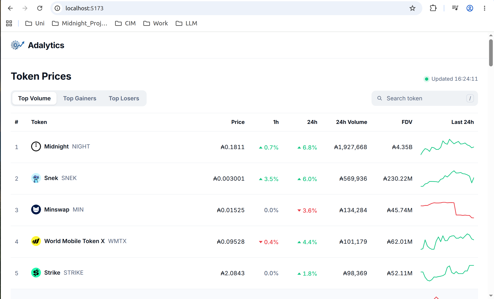
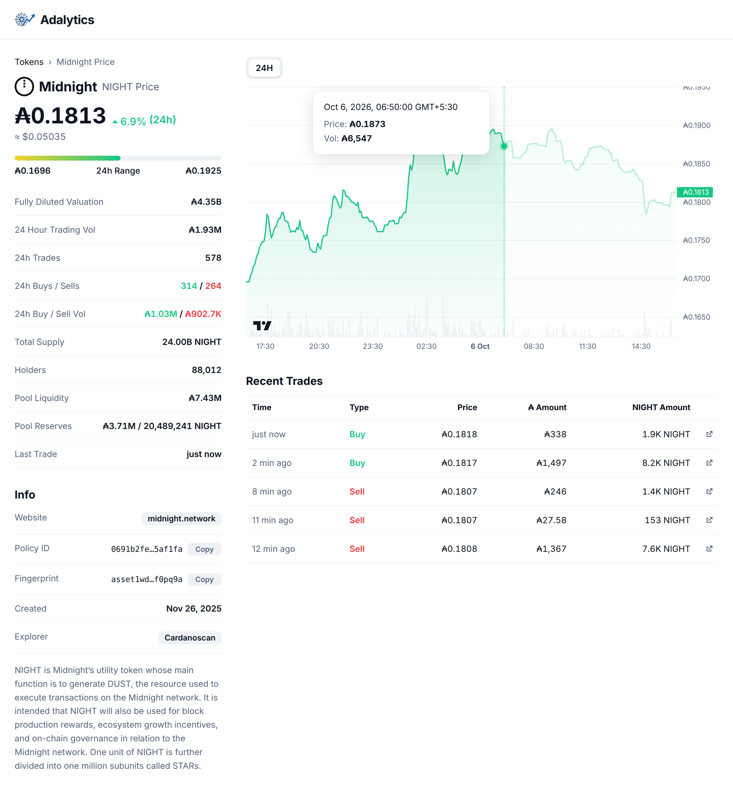
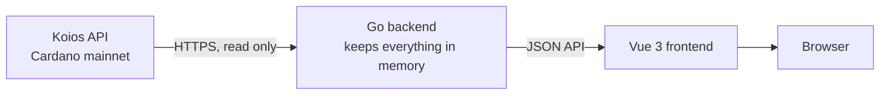
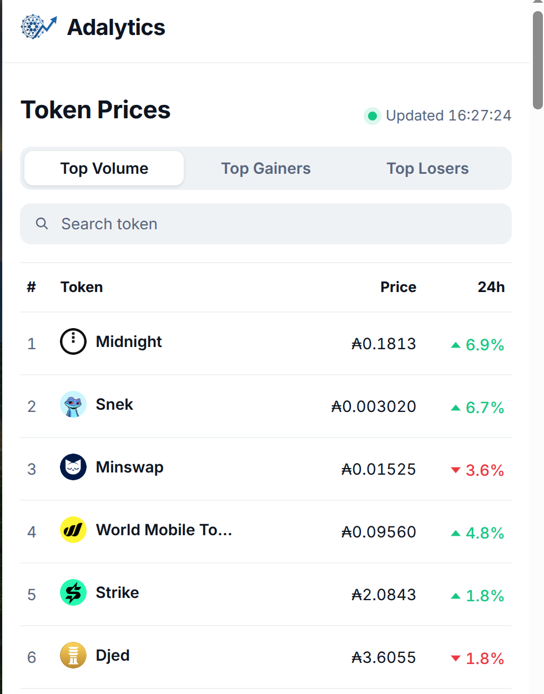

# Adalytics

**A Cardano token analytics platform.** Adalytics shows live prices, price charts and trading activity for Cardano native tokens, in the style of CoinGecko. Every number comes straight from the Cardano blockchain through the [Koios API](https://www.koios.rest).



## What it does

Adalytics tracks the 360 tokens that Minswap marks as verified and lists every one whose Minswap pool holds at least ₳10,000 (about 75 tokens on a normal day). Prices are in ADA, with a US dollar estimate next to them.

**Token list**

* Laid out like Birdeye: every listed token that traded in the last 24 hours (quiet ones show up when searched for), with price, FDV, volume, trades (Txns), liquidity, holders and the 1h, 4h and 24h change
* Top Volume, Gainers and Losers tabs (by 24h volume and 24h change)
* Click any column title to sort by it
* Each token shows its ticker, name, age and short policy ID with a copy button
* Search by name, ticker or policy ID (press `/` to jump to the search box)
* Refreshes by itself every minute
* While the backend starts, a progress box shows the percentage loaded and each step as it happens

**Token page**

* Live price chart (TradingView Lightweight Charts) as candles or a line, with volume bars. One slim bar on top, like Birdeye's: candle size (5m to 1 day, plus 1 week and 30 days once loaded), candles or line, indicators, and Price / FDV
* Scroll back through up to 30 days of history; while older history is still loading, the chart shows what is loaded so far
* A token panel like Birdeye's: price in ADA and USD, liquidity, FDV and holders in boxes, then 5m / 1h / 4h / 24h volume and trades with buys, sells and net
* Price performance (24h low and high), links and IDs with copy buttons, supply, pool reserves, last trade and the project description, like CoinMarketCap's info list
* Two tabs under the chart, like Birdeye's and DexScreener's. Trades: the latest trades, 10 at a time (up to 50), each with the wallet that made it and a link to the transaction on Cardanoscan; filter by Buys or Sells; trades of ₳10K and more are tagged BIG or WHALE. Top Traders: the 50 wallets that traded the token most in 24 hours, 7 or 30 days, ranked by volume or net buying, with what each bought and sold
* Click a trader to see only its trades, what it bought and sold in this token (over 24 hours, or 7 or 30 days from Top Traders), and which other tokens it traded in the last 24 hours. Minswap swaps several people's orders in one transaction; Adalytics splits them into one trade per wallet
* A drawing toolbar beside the chart, like TradingView's: trend line, horizontal line, rectangle, Fibonacci levels, text, a ruler that measures the price change and time between two points, zoom and scroll, a magnet that snaps to prices, hide and delete. Drawings stay in the browser only and are not saved

**Large Trades**

* Like Birdeye's Find Trades: the big trades across every token, up to 30 days back, newest first. A trade is big when it is at least 1% of its pool (it moves the price about 2%) or ₳10,000 and more
* Filters: a token search with suggestions and logos, time (last 1 hour to 30 days), size (small under ₳10K, big ₳10K–₳50K, whale ₳50K+) and wallet. The filters stay in the page address, so a view can be shared
* Each trade shows both sides of the swap, its share of the pool, the trader and a Cardanoscan link; 200 at a time with Show more

**Everywhere**

* A ☰ menu beside the logo opens Tokens and Large Trades
* Each browser tab names its page; a token page shows the live price, like "NIGHT ₳0.1890 +2.60% | Adalytics"
* A wrong address shows "Page not found" with a way back

It also works on phones.



## How it works



Adalytics is **read only**. It has no database and writes nothing to disk. When the backend starts, it loads what it needs from Koios into memory; when it stops, that memory is simply gone and is rebuilt on the next start.

**Where the prices come from.** Every token on Minswap V2 has a liquidity pool: one transaction output on the blockchain that holds ADA on one side and the token on the other. The pool's datum records both amounts. The price is simply

```
price in ADA = ADA in the pool / tokens in the pool
```

Whenever someone trades, the pool output is spent and a new one is created with the new amounts. Comparing one pool state with the next shows what happened:

* ADA went in and tokens came out: a **buy**
* tokens went in and ADA came out: a **sell**
* the pool's LP supply changed: someone added or removed liquidity, which is not counted as a trade
* changes under ₳1 are rounding dust and are ignored

**US dollar price.** Koios has no USD prices, so Adalytics uses the USDM stablecoin pool on Minswap: if 1 USDM costs ₳3.70, then ₳1 is worth about $0.27.

**What happens at startup**

1. List every Minswap transaction of the last 24 hours (`address_txs`, newest first)
2. Read the newest hour of them in batches of 50 (`tx_info`, three batches at a time): prices, 5m and 1h numbers and trades
3. Find the pools of the other tokens (`asset_utxos`, 30 tokens per request)
4. Load total supply, logos and project details (`asset_info`). The list opens now, about half a minute after the start
5. Read the rest of the 24 hours in the background, newest first; the 4h and 24h numbers fill in over the next minute or two, faded until they are complete
6. In the background, go back one day at a time until 30 days are loaded. The 7D and 30D charts, the 7 day change and the 7 day lines appear as soon as enough days are in
7. Count holders in the background (`asset_summary`, one token at a time)

The number of days is set with `HISTORY_DAYS` in `.env` (1 to 30, default 30). Fewer days means a lighter startup.

**What happens every minute**

1. Ask Koios whether any tracked pool output has been spent (`utxo_info`, 50 pools per request)
2. Only if one was spent, read the new transactions and update that token's price, chart and trades

## Koios usage and laptop load

Adalytics uses the free Koios tier (50,000 requests a day, 100 requests per 10 seconds) and stays well below it.

| | Measured |
|---|---|
| Requests for the first 24 hours | about 62 |
| Requests for 30 days of history | loaded once in the background; the backend log prints the exact count |
| Requests per minute after that | about 3 |
| Memory | about 25 MB with 24 hours loaded, more as older days load |
| CPU | close to 0% between the minute checks |

The backend also keeps itself inside Koios's limits: at most 90 requests per 10 seconds, request bodies under 5,120 bytes, and automatic retries when Koios is busy.

## Running it yourself

You need Go 1.22 or newer, Node.js 20 or newer, and a free Koios API token from [koios.rest](https://www.koios.rest).

**1. Settings.** Copy the example file and put your Koios token in it:

```bash
cp .env.example .env
```

**2. Backend** (starts on http://localhost:8080):

```bash
cd backend
go test ./...
go build -o adalytics . && ./adalytics
```

**3. Frontend** (in a second terminal, opens on http://localhost:5173):

```bash
cd frontend
npm install
npm run dev
```

While the backend does its first load, the site shows a loading box with the percentage and each step as it happens. The list opens by itself when it is done.

## Watching what the backend does

The backend's terminal shows everything that happens, one line each:

```
13:20:04 INFO  api     GET  /api/tokens/night/chart            200    4ms   18KB  visitor=203.0.113.7  id=a1f40c
13:20:09 WARN  api     GET  /api/tokens/xyz/chart              404   <1ms    34B  visitor=203.0.113.7  id=542d80  error="unknown token \"xyz\""
13:21:00 INFO  market  Checked 61 pools: 2 had new swaps
13:21:00 INFO  api     last minute: 37 requests from 3 visitors, 0 errors, 612KB sent, slowest 6ms (GET /api/tokens) | koios: 4 requests, 210KB received, today 3,412 of 50,000 (6.8%)
```

* **api** lines: every call from the website, with its status, time, size, the visitor's address and a request ID (also sent back in the `X-Request-ID` header, so a problem a visitor sees can be found in the log)
* **market** lines: what the tracker is doing with Koios data
* **koios** lines: every Koios request with how much data came back. These show with `LOG_LEVEL=debug` in `.env`; failed or very slow ones always show
* one **summary** line a minute: website traffic and Koios usage against the free tier's daily limit
* **WARN** and **ERROR** lines stand out: missing tokens, slow answers, Koios problems. If a request ever crashes, it is logged with details and the server keeps running

Logs only go to the terminal; nothing is written to disk.

## Project structure

Every file has one job and is under 250 lines. Every function has a comment explaining what it does. [docs/CODE_GUIDE.md](docs/CODE_GUIDE.md) explains how the parts fit together, and [docs/BACKEND_FUNCTIONS.md](docs/BACKEND_FUNCTIONS.md), [docs/MARKET_FUNCTIONS.md](docs/MARKET_FUNCTIONS.md), [docs/FRONTEND_FUNCTIONS.md](docs/FRONTEND_FUNCTIONS.md), [docs/CHART_FUNCTIONS.md](docs/CHART_FUNCTIONS.md), [docs/TRADES_FUNCTIONS.md](docs/TRADES_FUNCTIONS.md) and [docs/TOP_TRADERS_FUNCTIONS.md](docs/TOP_TRADERS_FUNCTIONS.md) list every function in plain words.

```
backend/
  main.go                       starts the tracker and the web server
  internal/config/              reads settings from .env
  internal/koios/
    client.go                   the Koios client; sends every request
    endpoints.go                one function per Koios endpoint
    types.go                    the shapes of Koios data
    retry.go                    retries and the rate limiter
    parallel.go                 runs batches of requests three at a time
  internal/minswap/pool.go      reads a Minswap V2 pool and works out the price
  internal/market/
    tokens.json                 the 360 verified tokens from Minswap's token list
    tracker.go                  the Tracker and its main loop
    startup.go                  the first load (the newest hour, then the list opens)
    day.go                      the rest of the first 24 hours, in the background
    backfill.go                 older history, loaded in the background
    update.go                   checks for new swaps every minute
    pools.go                    turns transactions into prices and trades
    fills.go                    splits a batch of orders into one trade per wallet
    wallets.go                  one wallet's trades, and the whale level
    whales.go                   the big trades across every token, for Large Trades
    traders.go                  a token's top traders, and one wallet's trades in it
    periods.go                  trading over 5m, 1h, 4h and 24h
    quotes.go                   the token list, charts and trades for the API
    details.go                  supply, logos, links and holder counts
    policy.go                   whether a token's minting policy is locked or open
    progress.go, activity.go    loading progress and live activity for the loading page
    history.go                  chart ranges (24H, 7D, 30D), line points and candles
    candles.go                  candle sizes (5m to 1D)
  internal/api/server.go        the JSON API used by the frontend
  internal/api/logging.go       logs every API call; catches crashes
  internal/api/stats.go         the summary line every minute
  internal/api/gzip.go          compresses answers so pages load faster
  internal/logx/handler.go      the log's line format and levels

frontend/src/
  pages/TokenList.vue           the token list
  components/ListToolbar.vue    the tabs, live status and search above it
  listSort.js                   the list's columns, periods and sorting
  components/TokenTable.vue     the token table
  pages/TokenPage.vue           the token page
  components/TokenOverview.vue  the token panel: name, links and the main numbers
  components/TokenInfo.vue      Minswap button, traders, holders, policy, price performance, links
  components/ChartPanel.vue     the chart and its data
  components/ChartHeader.vue    the bar on top of the chart
  components/LoadingProgress.vue  the loading box with live progress
  components/PriceChart.vue     the price chart (line or candles)
  components/ChartLegend.vue    the open, high, low, close line on the chart
  chart/useUnits.js             Price / FDV for the chart
  components/IndicatorMenu.vue  the Indicators button
  components/CandleSizePicker.vue  the candle size buttons and list
  chart/indicators.js           indicator math (MA, EMA, Bollinger, VWAP, RSI)
  chart/useIndicators.js        puts the indicators on the chart
  components/ChartToolbar.vue   the drawing toolbar beside the chart
  chart/drawingLayer.js         puts the drawings and the ruler on the chart
  chart/shapes.js               draws each kind of drawing
  chart/useDrawings.js          turns clicks into drawings; zoom, magnet and lock
  chart/useSelect.js            select, move and delete one drawing
  chart/hitTest.js              finds the drawing under the mouse
  components/TradesSection.vue  the Trades and Top Traders tabs on a token page
  components/RecentTrades.vue   the recent trades table, with filters
  components/TopTraders.vue     the Top Traders table
  components/TraderCell.vue     the Trader cell: short address and filter icon
  components/WalletCard.vue     the summary of the trader picked
  components/ActivityBox.vue    the 5m / 1h / 4h / 24h activity box
  pages/LargeTrades.vue         the Large Trades page
  components/TradeFilters.vue   its filter bar: token, time, size, wallet
  components/TokenPicker.vue    the token search with suggestions
  components/TradesTable.vue    its table
  tradeSizes.js                 small, big and whale: the trade sizes
  components/SizeTag.vue        the BIG / WHALE tag
  components/NavMenu.vue        the ☰ menu in the top bar
  pages/NotFound.vue            Page not found
  format.js                     number formats (₳, $, %, K/M/B)
```

**API**

| Endpoint | Returns |
|---|---|
| `GET /api/tokens` | every listed token with price, changes, volume and details, plus how much history is loaded |
| `GET /api/tokens/{id}/chart?range=7D` | line chart for one token: `range` is 24H, 7D or 30D |
| `GET /api/tokens/{id}/chart?type=candles&size=1h` | candles for one token: `size` is 5m (2 days back), 15m or 30m (7 days), 1h, 2h, 4h, 12h or 1D (30 days) |
| `GET /api/tokens/{id}/trades?limit=5` | the most recent trades for one token, each with its wallet; with `wallet=stake1…&hours=168`, that wallet's trades in it and its totals |
| `GET /api/tokens/{id}/traders?hours=24&sort=volume` | the token's top 50 wallets over 24 hours, 7 or 30 days, by volume or by net buying (`sort=net`) |
| `GET /api/wallets/{stake1…}` | what one wallet traded in the last 24 hours, token by token |
| `GET /api/whales?hours=24&min=10000&max=50000` | the big trades across every token for Large Trades (also `token`, `wallet`, `offset`), the token list and how much history is loaded |
| `GET /api/tokens/{id}/activity` | trading over 5m, 1h, 4h and 24h: change, volume, buys and sells |
| `GET /api/tokens/{id}/logo` | the token's logo from the Cardano token registry |

## Current limits

* Prices come from Minswap V2 only. Tokens that mostly trade on other exchanges may show lower volume than sites that combine every exchange, such as DexHunter.
* History is kept in memory only, so after every restart the 30 days are loaded again from Koios.
* Ranking is by 24 hour volume, because circulating supply (needed for market cap) is not known for every token.
* Minswap fills orders in batches; Adalytics splits them into one trade per wallet. When the amounts do not add up for certain, the swap is shown as one trade without a wallet, never with a wrong one.

## Built with

Go, Vue 3 (Composition API), Vite, Vue Router, TradingView Lightweight Charts, Koios API, and the Minswap verified token list.


