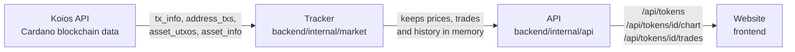

# Code guide

This guide explains how Adalytics is built. Read it to see how the pieces fit together. Every function is listed in plain words in these files, so no file is too long:

- [Backend functions](BACKEND_FUNCTIONS.md): the Go backend and its tests
- [Market functions](MARKET_FUNCTIONS.md): the market package (prices, history, candles) and its tests
- [Frontend functions](FRONTEND_FUNCTIONS.md): the Vue website
- [Chart functions](CHART_FUNCTIONS.md): the price chart, its units, indicators and drawing tools

Every function in the code also has a comment above it saying the same thing, so you can read the code on its own too.

## How it works

The app has two parts that run side by side:

- **The backend** (Go, in `backend/`) reads Cardano data from the Koios API, works out prices, volume and trades, and keeps everything in memory. It never writes to the blockchain.
- **The frontend** (Vue 3, in `frontend/`) is the website. It only talks to the backend, never to Koios directly.

### What happens when the backend starts

1. **First load (about half a minute).** The Tracker lists every Minswap transaction of the last 24 hours, reads the newest hour of them to get pool sizes (which give prices and trades), finds the pools of the other tokens, and loads supply, logos and links. While this runs, the website shows the loading box with live progress (`LoadingProgress.vue`). Then the list opens, and the rest of the 24 hours is read in the background (`day.go`); the 4h and 24h numbers are faded until they are complete. Batches of transactions are read three at a time.
2. **Background history.** After the first load, older history (up to 30 days) loads in the background, so the 7D and 30D charts become available a few minutes later. The site can be used meanwhile.
3. **Every minute after that.** The Tracker checks which pools were used since the last check and reads only those new swaps. This costs about 3 Koios requests a minute.
4. **Every 6 hours.** Holder counts are refreshed in the background, because Koios is slow to count them.

### Reading the log

Everything the backend does is written to its terminal, one line each: `api` for every call from the website (status, time, size, visitor, request ID), `market` for the tracker, `koios` for every Koios request and how much data came back (with `LOG_LEVEL=debug`), and one summary line a minute with website traffic and Koios usage for the day. WARN and ERROR lines stand out. The format is set in `internal/logx`, the API log in `internal/api/logging.go` and the summary in `internal/api/stats.go`.

### How a price is worked out

Each Minswap pool holds ADA and one token. The price is the ratio of the two: if a pool holds 2,000,000 ADA and 744,260,765 SNEK, one SNEK costs about ₳0.0027. When someone swaps, the pool's amounts change. ADA going in and tokens coming out is a buy; the other way round is a sell. That is how the trades list is built (`tradeFrom` in `pools.go`).

Minswap does not swap each order on its own: a batcher swaps several people's orders in one transaction, and pays each person back. `fills.go` splits the transaction into one trade per order; the trader is the wallet the payout goes to. When the amounts do not add up for certain, the swap is shown as one trade without a wallet, never with a wrong one.

## The API

The backend serves these routes. Each one reads from memory, so they answer instantly.

| Route | What it returns |
|---|---|
| `GET /api/tokens` | Every listed token with price, FDV, liquidity and its 5m, 1h, 4h and 24h change, volume, buys and sells, plus how much history is loaded (and the loading progress during the first load) |
| `GET /api/tokens/{id}/chart?range=24H` | One token's line chart. `range` is 24H, 7D or 30D |
| `GET /api/tokens/{id}/chart?type=candles&size=1h` | One token's candles. `size` is 5m (2 days back), 15m or 30m (7 days), 1h, 2h, 4h, 12h or 1D (30 days) |
| `GET /api/tokens/{id}/trades?limit=50` | One token's latest trades, newest first, each with its wallet, and the whale level |
| `GET /api/wallets/{stake1…}` | What one wallet traded in the last 24 hours, token by token |
| `GET /api/tokens/{id}/activity` | One token's trading over 5m, 1h, 4h and 24h: price change, volume, buys and sells |
| `GET /api/tokens/{id}/logo` | The token's logo from the Cardano token registry (PNG) |
| `GET /api/health` | `{"status": "ok"}` when the backend is running |

## Where everything is

No file is longer than 300 lines. Each one has one job.

### Backend

| File | Job |
|---|---|
| `main.go` | Starts everything and stops it cleanly on Ctrl+C |
| `internal/config/config.go` | Reads settings from `.env` |
| `internal/koios/client.go` | The Koios client and the function that sends every request |
| `internal/koios/endpoints.go` | One function per Koios endpoint used |
| `internal/koios/types.go` | The shapes of the data Koios returns |
| `internal/koios/retry.go` | Retry timing and the rate limiter (stays under the free tier's limit) |
| `internal/koios/parallel.go` | Runs batches of requests three at a time |
| `internal/minswap/pool.go` | Reads a Minswap pool and its price from a Koios UTxO |
| `internal/market/tracker.go` | The Tracker type, its settings and the main loop |
| `internal/market/startup.go` | The first load: the newest hour, then the list opens |
| `internal/market/day.go` | The rest of the first 24 hours, in the background |
| `internal/market/backfill.go` | Older history, loaded in the background |
| `internal/market/update.go` | The check for new swaps every minute |
| `internal/market/pools.go` | Turns transactions into pool states, prices and trades |
| `internal/market/fills.go` | Splits a batch of orders into one trade per wallet |
| `internal/market/wallets.go` | One wallet's trades across tokens, and the whale level |
| `internal/market/periods.go` | Trading over 5m, 1h, 4h and 24h for the activity box |
| `internal/market/quotes.go` | What the API reads: token list, charts, trades, logos |
| `internal/market/details.go` | Supply, logos, links and holder counts |
| `internal/market/progress.go` | Loading progress for the loading page |
| `internal/market/activity.go` | The live activity feed for the loading page |
| `internal/market/history.go` | Chart ranges, chart points, candles and price changes |
| `internal/market/tokens.go` | The list of verified tokens (from `tokens.json`) |
| `internal/market/format.go` | Small number and text helpers for the log |
| `internal/api/server.go` | The API routes |
| `internal/api/logging.go` | Logs every API call with a request ID, and catches crashes |
| `internal/api/stats.go` | Counts traffic and logs a summary every minute |
| `internal/api/gzip.go` | Compresses JSON answers so pages load faster |
| `internal/logx/handler.go` | The log's line format, levels and number formats |

### Frontend

| File | Job |
|---|---|
| `src/main.js` | Starts the app and sets up the two pages (list and token page) |
| `src/App.vue` | The top bar and the page frame |
| `src/useTokens.js` | Loads the token list from the backend and refreshes it |
| `src/format.js` | Formats prices, percentages, amounts and dates |
| `src/chartPrefs.js` | Remembers candles or line, the candle size, indicators and Price / FDV, between token pages |
| `src/pages/TokenList.vue` | The token list (Top Volume, Gainers, Losers, period, sort, search) |
| `src/components/ListToolbar.vue` | The bar above the list: tabs, the 5m / 1h / 4h / 24h bar and the search box |
| `src/listSort.js` | The list's columns, periods and sorting |
| `src/components/TokenTable.vue` | The token table: sortable columns, faded numbers while loading, the empty message |
| `src/pages/TokenPage.vue` | One token's page: price, stats, info, chart and trades |
| `src/components/ChartPanel.vue` | The chart and its data: the candles at the picked size, refreshed every minute |
| `src/components/ChartHeader.vue` | The slim bar on top of the chart: candle size, candles or line, indicators, Price / FDV |
| `src/components/LoadingProgress.vue` | The loading box shown during the first load |
| `src/components/PriceChart.vue` | The line and candle chart (TradingView Lightweight Charts) |
| `src/components/ChartLegend.vue` | The open, high, low, close line at the top of the chart, and the indicator values |
| `src/components/IndicatorMenu.vue` | The Indicators button and its list |
| `src/components/CandleSizePicker.vue` | The candle size buttons and list, with loading progress |
| `src/chart/indicators.js` | The indicator math: MA, EMA, Bollinger Bands, VWAP, RSI |
| `src/chart/useIndicators.js` | Puts the picked indicators on the chart |
| `src/components/ChartToolbar.vue` | The drawing toolbar beside the chart |
| `src/components/ToolGroup.vue` | The line tools button and its list |
| `src/components/ToolIcon.vue` | A drawing tool's icon |
| `src/chart/drawingLayer.js` | A chart plugin that puts the drawings and the ruler on the chart |
| `src/chart/shapes.js` | Draws each kind of drawing and the ruler |
| `src/chart/useDrawings.js` | Turns clicks into drawings, and handles zoom, the magnet and the lock |
| `src/chart/useSelect.js` | Select, move, reshape and delete one drawing |
| `src/chart/hitTest.js` | Finds the drawing under the mouse |
| `src/components/RecentTrades.vue` | The recent trades table on a token page, with filters and Show more |
| `src/components/TraderCell.vue` | The Trader cell: short address and filter icon |
| `src/components/WalletCard.vue` | The summary of the trader picked |
| `src/components/ActivityBox.vue` | The 5m / 1h / 4h / 24h box: change, volume, buys, sells, net buy |
| `src/components/Change.vue` | A green ▲ or red ▼ percentage |
