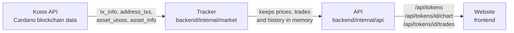

# Code guide

This guide explains how Adalytics is built and what every function does. Read the first part to see how the pieces fit together, then use the tables to look up a function.

Every function in the code also has a comment above it saying the same thing, so you can read the code on its own too.

## How it works

The app has two parts that run side by side:

- **The backend** (Go, in `backend/`) reads Cardano data from the Koios API, works out prices, volume and trades, and keeps everything in memory. It never writes to the blockchain.
- **The frontend** (Vue 3, in `frontend/`) is the website. It only talks to the backend, never to Koios directly.

### What happens when the backend starts

1. **First load (about 3 to 5 minutes).** The Tracker lists every Minswap transaction of the last 24 hours, reads each one to get pool sizes (which give prices and trades), finds the pools of tokens that did not trade, and loads supply, logos and links. While this runs, the website shows the loading page with live progress (`LoadingProgress.vue`).
2. **Background history.** After the first load, older history (up to 30 days) loads in the background, so the 7D and 30D charts become available a few minutes later. The site can be used meanwhile.
3. **Every minute after that.** The Tracker checks which pools were used since the last check and reads only those new swaps. This costs about 3 Koios requests a minute.
4. **Every 6 hours.** Holder counts are refreshed in the background, because Koios is slow to count them.

### How a price is worked out

Each Minswap pool holds ADA and one token. The price is the ratio of the two: if a pool holds 2,000,000 ADA and 744,260,765 SNEK, one SNEK costs about ₳0.0027. When someone swaps, the pool's amounts change. ADA going in and tokens coming out is a buy; the other way round is a sell. That is how the trades list is built (`tradeFrom` in `pools.go`).

## The API

The backend serves these routes. Each one reads from memory, so they answer instantly.

| Route | What it returns |
|---|---|
| `GET /api/tokens` | Every listed token with price, changes, volume and small price lines, plus how much history is loaded (and the loading progress during the first load) |
| `GET /api/tokens/{id}/chart?range=24H&type=line` | One token's chart. `range` is 24H, 7D or 30D; `type` is line or candles |
| `GET /api/tokens/{id}/trades?limit=50` | One token's latest trades, newest first |
| `GET /api/tokens/{id}/logo` | The token's logo from the Cardano token registry (PNG) |
| `GET /api/health` | `{"status": "ok"}` when the backend is running |

## Where everything is

No file is longer than 300 lines. Each one has one job.

### Backend

| File | Job |
|---|---|
| `main.go` | Starts everything and stops it cleanly on Ctrl+C |
| `internal/config/config.go` | Reads settings from `.env` |
| `internal/koios/client.go` | The Koios client and the function that sends every request |
| `internal/koios/endpoints.go` | One function per Koios endpoint used |
| `internal/koios/types.go` | The shapes of the data Koios returns |
| `internal/koios/retry.go` | Retry timing and the rate limiter (stays under the free tier's limit) |
| `internal/minswap/pool.go` | Reads a Minswap pool and its price from a Koios UTxO |
| `internal/market/tracker.go` | The Tracker type, its settings and the main loop |
| `internal/market/startup.go` | The first load (last 24 hours) |
| `internal/market/backfill.go` | Older history, loaded in the background |
| `internal/market/update.go` | The check for new swaps every minute |
| `internal/market/pools.go` | Turns transactions into pool states, prices and trades |
| `internal/market/quotes.go` | What the API reads: token list, charts, trades, logos |
| `internal/market/details.go` | Supply, logos, links and holder counts |
| `internal/market/progress.go` | Loading progress for the loading page |
| `internal/market/activity.go` | The live activity feed for the loading page |
| `internal/market/history.go` | Chart ranges, chart points, candles and price changes |
| `internal/market/tokens.go` | The list of verified tokens (from `tokens.json`) |
| `internal/market/format.go` | Small number and text helpers for the log |
| `internal/api/server.go` | The API routes |

### Frontend

| File | Job |
|---|---|
| `src/main.js` | Starts the app and sets up the two pages (list and token page) |
| `src/App.vue` | The top bar and the page frame |
| `src/useTokens.js` | Loads the token list from the backend and refreshes it |
| `src/format.js` | Formats prices, percentages, amounts and dates |
| `src/loadingSteps.js` | The text of the loading page's steps |
| `src/chartPrefs.js` | Remembers line or candles, and the range, between token pages |
| `src/pages/TokenList.vue` | The token list (Top Volume, Top Gainers, Top Losers, search) |
| `src/pages/TokenPage.vue` | One token's page: price, chart, stats, info and trades |
| `src/components/LoadingProgress.vue` | The loading page shown during the first load |
| `src/components/LoadingActivity.vue` | The loading page's live feed of what the backend is doing |
| `src/components/PriceChart.vue` | The line and candle chart (TradingView Lightweight Charts) |
| `src/components/RecentTrades.vue` | The recent trades table on a token page |
| `src/components/Sparkline.vue` | The small price line in the list |
| `src/components/Change.vue` | A green ▲ or red ▼ percentage |

# Every function

## Backend functions

### `main.go`

| Function | What it does |
|---|---|
| `main` | Loads the settings, starts the Tracker that reads Cardano data from Koios in the background, and serves the API until Ctrl+C is pressed. |

### `internal/config/config.go`

| Function | What it does |
|---|---|
| `Load` | Reads .env (from the current folder, or the parent folder) and then the environment. Values already set in the environment win over the file. |
| `getenv` | Returns the environment variable key, or fallback when it is empty or not set. |
| `loadDotEnv` | Reads the first file that exists. Lines look like KEY=VALUE; blank lines and lines starting with # are skipped. |

### `internal/koios/client.go`

| Function | What it does |
|---|---|
| `New` | Creates a Client for the Koios API at baseURL, using the API token. |
| `Requests` | The number of requests sent to Koios since start, retries included. |
| `do` | Sends a request and decodes the JSON answer into out. It waits for the rate limiter and retries when Koios is busy (429), slow or briefly down (5xx). |

### `internal/koios/endpoints.go`

| Function | What it does |
|---|---|
| `Tip` | Returns the newest block Koios knows about: its height and time. |
| `UTxOInfo` | Looks up UTxOs by reference ("tx_hash#index") and says if each is spent. |
| `PoolUTxOs` | Returns the unspent outputs at address that hold any of the given assets. Each Minswap pool holds its own LP token, so asking for the LP tokens at the pool address returns exactly those pools, traded recently or not. Requests are split so each body stays under Koios's size limit. |
| `AddressTxsPage` | Returns one page of the transactions that touched the addresses from a block height on, newest first. |
| `AddressTxs` | Lists every transaction that touched the addresses from a block height on (newest first). Koios returns at most 1000 rows per page, so it pages through; progress, if set, is called after each page. |
| `AssetInfos` | Returns supply and registry details for several tokens in one request. |
| `AssetSummary` | Asks Koios how many wallets hold a token. It uses the slow HTTP client, because Koios can take minutes to count big tokens. |
| `TxInfo` | Returns transactions with their outputs, assets and inline datums. |

### `internal/koios/retry.go`

| Function | What it does |
|---|---|
| `Error` | Returns the message, so retryAfter can be used as an error. |
| `parseRetryAfter` | Reads the Retry-After header (in seconds). Without one it waits 60 seconds, about how long Koios blocks after too many requests. |
| `snippet` | Shortens an error response to 200 characters for the log. |
| `sleep` | Waits for d, or returns early with an error when ctx is cancelled. |
| `wait` | Blocks until another request is allowed: it forgets requests older than the window, and if max are still in it, sleeps until the oldest leaves. |

### `internal/koios/types.go`

| Function | What it does |
|---|---|
| `IsADA` | Reports whether the asset is ADA itself rather than a native token. |
| `Ref` | The UTxO reference "tx_hash#index". |
| `UTxO` | Converts a transaction output into the same shape as a UTxO lookup. |

### `internal/minswap/pool.go`

| Function | What it does |
|---|---|
| `Parse` | Turns one Koios UTxO into a Pool. |
| `IsADAPair` | Reports whether this is the ADA / token pool. |
| `PriceADA` | The price of one whole token in ADA: (reserve A / 10^6) / (reserve B / 10^decimals). |
| `ReserveADA` | Returns reserve A in ADA. |
| `ReserveToken` | Returns reserve B in whole tokens (after the token's decimals). |
| `asset` | Reads an asset (policy ID and name) from a pool datum field. |
| `integer` | Reads a whole number from a pool datum field. Reserves can be larger than 64 bits, so it returns a big.Int. |
| `pow10` | Returns 10 to the power n, used to apply a token's decimals. |
| `scaled` | Turns an amount in the smallest unit into whole units, e.g. 1,500,000 lovelace with 6 decimals is 1.5 ADA. |

### `internal/market/activity.go`

| Function | What it does |
|---|---|
| `Note` | Writes a message to the log and, while the first load is running, also keeps it for the loading page. It is exported so main can report Koios retries ("Koios is busy, trying again in 15s") the same way. Do not call Note while holding t.mu: it takes the lock itself. |
| `recentActivity` | Returns the kept messages, newest first, as a copy so the caller can use it after the lock is released. Call with t.mu held. |
| `timeLeft` | Guesses the seconds left in the first load from how long it has taken so far and how far it has got. It returns 0 (unknown) until at least 5% is done, because earlier guesses jump around too much. |

### `internal/market/backfill.go`

| Function | What it does |
|---|---|
| `backfillLoop` | Waits for the first load, then loads the rest of the history. |
| `backfill` | Loads the history older than the first 24 hours, newest first, one page of 1,000 transactions at a time, so 7 days are ready long before 30. A page that fails is tried again a minute later. |
| `finishHistory` | Marks the whole history span as loaded, so every chart range is ready. |

### `internal/market/details.go`

| Function | What it does |
|---|---|
| `loadInfo` | Reads total supply, ticker and logo for every tracked token with asset_info, 25 tokens per request. If it fails, prices still work and it is tried again next minute. |
| `holdersLoop` | Counts holders now, then again every HoldersEvery, until ctx ends. |
| `loadHolders` | Counts the holders of each token in the current top list: wallets with a stake key plus addresses without one. One slow asset_summary request per token. |
| `safeURL` | Keeps a registry website only if it is a plain http(s) link, so a token's metadata cannot put another kind of link on the page. |

### `internal/market/format.go`

| Function | What it does |
|---|---|
| `scaled` | Turns an amount in the smallest unit into whole units, e.g. 1,500,000 lovelace with 6 decimals is 1.5 ADA. |
| `plural` | Returns "s" unless n is 1, for log messages like "2 swaps". |
| `FormatADA` | Shows a price with 4 significant digits, e.g. ₳0.002657. |
| `change` | Describes a price move for the log, e.g. "▲ 2.10%". |
| `group` | Formats a number as 1,977,518. |

### `internal/market/history.go`

| Function | What it does |
|---|---|
| `RangeByKey` | Finds a range by its key ("24H", "7D", "30D"), ignoring case. |
| `priceAt` | Returns the price at time t: the last swap at or before t. If every swap is after t, the first known price is used. |
| `bucket` | Turns swaps into evenly spaced chart points between from and to. Each point carries the last price in its interval (or the previous price if nothing traded) and the ADA volume traded in it. |
| `changePct` | The percentage change from the price at time t to now. |
| `volumeSince` | Adds up the ADA traded from time t (unix seconds) until now. |
| `candles` | Groups swaps into candlesticks between from and to. A slot with no swaps is a flat candle at the previous close, and each candle opens at the previous close so the candles join up. |

### `internal/market/pools.go`

| Function | What it does |
|---|---|
| `readPools` | Reads transactions with tx_info (50 per request) and returns, for each token, the pool state after each of its transactions, oldest first. |
| `merge` | Adds pool states to a token's history (skipping ones it already has), keeps the history in chain order and rebuilds prices, volume and trades. It returns how many states were new. Call with t.mu held. |
| `rebuild` | Works out a token's price points, volume and trades from its pool history, drops history older than the kept span (keeping the last state before it, so the price at the start is known) and updates the quote from the newest pool state. Call with t.mu held. |
| `tradeFrom` | Turns the change in a pool's reserves into a trade. ADA going in while tokens come out is a buy; the other way round is a sell. |

### `internal/market/progress.go`

| Function | What it does |
|---|---|
| `History` | Returns how much history is loaded and which chart ranges are ready. |
| `setBoot` | Changes the first load's progress safely while other code reads it. |
| `bootLoading` | Turns the first load's progress into steps and one percentage: listing 0-10%, reading 10-80%, quiet tokens 80-95%, details 95-100%. Call with t.mu held. |
| `rangeReady` | Reports whether the whole range is loaded. Call with t.mu held. |

### `internal/market/quotes.go`

| Function | What it does |
|---|---|
| `Quotes` | Returns the top TopN tokens ranked by 24h trading volume. Only tokens with a Minswap pool holding at least MinPoolADA are ranked; tokens that did not trade in 24h follow, by pool size. |
| `sparkline` | The price at every step from start to end, for the list's small lines. |
| `usdPerADA` | The ADA/USD rate from the USDM pool (1 USDM ≈ 1 USD), or 0 if that pool is not tracked. Call with t.mu held. |
| `Chart` | Returns one token's chart for a range: evenly spaced line points, or candles when candles is true. |
| `Trades` | Returns a token's most recent trades of the last 24 hours, newest first, at most limit (and never more than MaxTrades). |
| `Logo` | Returns a token's PNG logo from the token registry, if it has one. |

### `internal/market/startup.go`

| Function | What it does |
|---|---|
| `loadHistory` | The first load, kept short so the site is usable within a few minutes: 1. every Minswap V2 transaction of the last 24 hours (address_txs, then tx_info 50 at a time): prices, volume and trades, and the pool of every token that traded; 2. the current pool of each token that did not trade in 24 hours (asset_utxos, 30 tokens per request). Older history is loaded afterwards in the background (backfill). |
| `findPools` | Asks Koios which UTxOs at the Minswap pool address hold each token's LP token: that UTxO is the token's pool, as it is now. |

### `internal/market/tokens.go`

| Function | What it does |
|---|---|
| `mustLoadTokens` | Reads the embedded tokens.json. It stops the program if the file is broken, because nothing can work without the token list. |

### `internal/market/tracker.go`

| Function | What it does |
|---|---|
| `chainOrder` | Gives one number for sorting transactions in the order they happened: block height first, then position inside the block. |
| `NewTracker` | Prepares a Tracker for the given tokens. Nothing is loaded until Run is called. |
| `SetHistoryDays` | Sets how many days of history are loaded and kept (1 to 30). Call it before Run. |
| `assignSlugs` | Gives each token a short unique id, normally its ticker in lower case; tokens sharing a ticker get part of their policy ID added. |
| `Run` | Loads history now, then checks for new swaps every interval, until ctx ends. Holder counts are loaded separately in the background. |
| `refresh` | Runs once a minute: the first time it does the first load, and after that it loads token details if they are still missing and checks for new swaps. |
| `tracked` | Returns the tokens whose pool was found and holds at least MinPoolADA: the ones listed and checked every minute. Call with t.mu held. |
| `sleepCtx` | Waits for d, or returns early with an error when ctx is cancelled. |
| `blocksIn` | About how many blocks Cardano makes in d. |
| `failAll` | Records an error that affects every token and logs it once. |

### `internal/market/update.go`

| Function | What it does |
|---|---|
| `update` | Checks the chain tip and, with utxo_info (50 pools per request), which pools were spent (a swap happened) since the previous check. Only then it reads Minswap's transactions since that check and takes the new pool states. |

### `internal/api/server.go`

| Function | What it does |
|---|---|
| `New` | Builds the HTTP handler with every API route. Each route only reads from the Tracker's memory, so it answers instantly and never calls Koios. |
| `writeJSON` | Sends v as JSON with the given HTTP status, and tells the browser not to cache it, so prices are always fresh. |
| `withCORS` | Lets the Vue dev server (another port) read the API. Read-only: GET only. |

## Backend tests

Run them with `go test ./...` from `backend/`. They use a fake Koios server, so they need no internet and no API token.

### `internal/minswap/pool_test.go`

| Function | What it does |
|---|---|
| `loadFixture` | testdata/snek_pools.json is real Koios output (SNEK/MIN pool and SNEK/ADA pool). |
| `TestParseSNEKADAPool` | Reads a real SNEK/ADA pool and checks its assets, reserves and price. |
| `TestPriceUsesTokenDecimals` | Checks that a token's decimals are applied when working out the price. |

### `internal/market/charts_test.go`

| Function | What it does |
|---|---|
| `TestBucketCarriesPriceForward` | Checks that chart steps with no trade keep the last price, and that volume is added up per step. |
| `TestFormatADA` | Checks prices are shown with 4 significant digits. |
| `TestCandles` | Checks open, high, low and close for each candle. |

### `internal/market/helpers_test.go`

| Function | What it does |
|---|---|
| `loadPools` | Reads real Minswap pools (SNEK/MIN and SNEK/ADA) saved from Koios. |
| `poolOutput` | The real SNEK/ADA pool from testdata with a chosen ADA reserve. |
| `swapOutput` | The SNEK/ADA pool with chosen LP supply and reserves (SNEK has 0 decimals). |
| `otherOutput` | An output of some other Minswap pool (not one of ours). |
| `serve` | Answers each Koios endpoint the Tracker uses from the fake's data, and records every request. |
| `snekToken` | SNEK from tokens.json. |
| `newTracker` | Starts a fake Koios server and a Tracker for SNEK that uses it, with the clock fixed at testNow. |

### `internal/market/history_test.go`

| Function | What it does |
|---|---|
| `TestBackfillLoadsOlderHistory` | Checks that 7 days of history are loaded in the background, and that the 7D chart and change appear only once they are. |
| `TestBackfillWhileUpdating` | The background history load runs while the minute updates and the API read the same tokens; run them together so the race detector can check it. |
| `TestLoadingProgress` | Checks the loading screen's steps and percentage. |

### `internal/market/quotes_test.go`

| Function | What it does |
|---|---|
| `TestTradesFromSwaps` | Checks that buys and sells are worked out from pool changes, and that dust and liquidity deposits are not counted as trades. |
| `TestUSDPriceFromUSDMPool` | Checks USD prices come from the USDM pool, and are left empty when that pool is missing. |
| `TestSafeURL` | Checks that only plain http(s) website links are kept. |
| `TestRankingAndIDs` | Checks the ranking by volume then pool size, that small pools are left out, and that tokens sharing a ticker get unique ids. |

### `internal/market/tracker_test.go`

| Function | What it does |
|---|---|
| `TestLoadsHistoryThenFollowsSwaps` | Checks the first 24 hour load (price, volume, change, chart), then that a new swap is picked up a minute later. |
| `TestQuietTokenIsListed` | Checks that a token with a pool but no trades today is still listed, with a flat price line. |
| `TestTokenWithoutPoolIsLeftOut` | Checks that a token with no Minswap pool is not listed. |
| `TestFindsAllPoolsInSmallRequests` | Checks that the pool search is split into requests small enough for the Koios free tier. |

## Frontend functions

### `src/useTokens.js`

| Function | What it does |
|---|---|
| `load` | Fetches /api/tokens once and stores the tokens, history and any error. |
| `schedule` | Plans the next refresh: fast during the first load, slower after it. |
| `useTokens` | Loads the list when the first page using it opens and refreshes it while any page using it is open: every 3 seconds during the first load, every 15 seconds while 7D / 30D load, and every minute after that. |

### `src/format.js`

| Function | What it does |
|---|---|
| `formatPrice` | ₳0.1699, ₳0.002681, and for tiny prices CoinGecko-style ₳0.0₇3391 (the small 7 means seven zeros after the decimal point). |
| `formatUSD` | $0.0503, $1.01, $0.0₇8970: a price in US dollars, same style as formatPrice. |
| `priceWith` | Formats a price with ₳ or $, using 4 significant digits and the small-number style for tiny prices. formatPrice and formatUSD both use it. |
| `fullPrice` | Full price for tooltips, e.g. 0.00000003391 |
| `formatADA` | ₳1,234,567 (whole ADA), like CoinGecko's volume and market cap columns. |
| `formatPct` | Shows a change as a percentage with one decimal, without its sign: the arrow and colour show the direction. |
| `formatTime` | Shows the clock time, e.g. 14:05:09. |
| `formatAgo` | "just now", "12 min ago", "3 hours ago", "4 days ago" |
| `formatCompact` | ₳3.71T, ₳3.35M, ₳309.9K, ₳812, like CoinGecko's stats column. |
| `formatDateTime` | "Oct 5, 2026, 13:20:00 GMT+5:30" for chart tooltips. |
| `formatAmount` | 76.72B, 21.0M, 940K: token amounts without the ₳ sign. |
| `short` | Shortens a long id for the info box: the first 8 and last 6 characters. |
| `host` | Shows only the website's name, e.g. https://www.snek.com/x → snek.com. |
| `createdDate` | Shows a date like Apr 24, 2023. |

### `src/loadingSteps.js`

| Function | What it does |
|---|---|
| `n` | Formats a whole number with thousands separators: 12345 → "12,345". |
| `stepCount` | The number shown next to a step, e.g. "1,200 / 3,400". Steps not started yet, and the details step, show nothing. |
| `formatDuration` | Turns seconds into short text: 45 → "45s", 135 → "2m 15s". |
| `clockTime` | Shows an ISO time as the local clock time, e.g. "10:42:07". |

### `src/components/Change.vue`

| Function | What it does |
|---|---|
| `dir` | Decides the colour and arrow: up, down, flat (rounds to 0.0%) or none (no value). |

### `src/components/LoadingProgress.vue`

| Function | What it does |
|---|---|
| `sinceUpdate` | How many seconds ago the last progress arrived. |
| `elapsed` | How long the first load has been running. |
| `leftText` | The time-left estimate, counting down between updates. |
| `activeStep` | The step running now, for the heading under the percentage. |

### `src/components/PriceChart.vue`

| Function | What it does |
|---|---|
| `rgba` | Turns a colour like #16c784 into rgba() with transparency a (0 to 1). |
| `isCandles` | Reports whether the chart shows candles instead of a line. |
| `paint` | Line mode: colour and bold/faded split for the hovered point (-1 = none). |
| `load` | Puts the current points or candles into the chart and fits the view. |
| `pct` | How much a candle moved from open to close, in percent, for the tooltip. |

### `src/components/RecentTrades.vue`

| Function | What it does |
|---|---|
| `load` | Asks the backend for this token's latest trades and keeps any error to show. |
| `ada` | ₳1,250 for normal amounts, ₳4.35 for small ones. |

### `src/components/Sparkline.vue`

| Function | What it does |
|---|---|
| `flat` | No trades in the period: every value is the same price. |
| `color` | Green if the price ended higher than it started, red if lower, grey if flat. |
| `points` | Turns the prices into SVG line coordinates that fill the width and height. |

### `src/pages/TokenList.vue`

| Function | What it does |
|---|---|
| `weekRange` | The backend's loading status of the 7 day history. |
| `weekReady` | True once 7 days of history are loaded. |
| `week` | True when the list shows 7 day numbers. |
| `setPeriod` | Picks 24h or 7d; 7d only works once it is loaded. |
| `changeOf` | A token's price change for the chosen period. |
| `lineOf` | A token's small price line for the chosen period. |
| `lineLabel` | The title of the small price line column. |
| `periodText` | The period in words, for messages like "No token is up in the last 24 hours". |
| `moved` | A change that rounds to 0.0% is not a gain or a loss. |
| `active` | True if the token traded in the chosen period. |
| `place` | Place in the Top Volume list (the backend's order without the quiet tokens); quiet tokens found by search have no place. |
| `shown` | The list on screen: the chosen view (volume, gainers or losers), filtered by the search box. |
| `emptyText` | Explains why the list is empty. |
| `open` | Goes to a token's page. |
| `onKey` | Makes "/" jump to the search box from anywhere on the page. |

### `src/pages/TokenPage.vue`

| Function | What it does |
|---|---|
| `token` | The token this page is about, found by the id in the address. |
| `back` | Goes to the previous page if it was the list, otherwise opens the list. |
| `ranges` | Range buttons. Every range can be clicked; if its history is still loading, the chart area shows the live loading percentage until the chart is ready. |
| `selected` | The chart range picked now (24H, 7D or 30D). |
| `waiting` | True while the picked range is still loading in the backend. |
| `setType` | Switches the chart between line and candles. |
| `setRange` | Switches the chart to another range. |
| `loadChart` | Fetches the chart for the picked range and type. If the range is not ready it clears the chart, and the loading percentage is shown instead. |
| `copy` | Puts text (a policy ID or fingerprint) on the clipboard and shows "Copied" next to it for 1.5 seconds. |
| `lows` | Low / high over the chart's range, from the line points or the candles. |
| `highs` | The highest prices in the chart (candle highs, or line prices). |
| `low` | The lowest price over the chart's range. |
| `high` | The highest price over the chart's range. |
| `rangeLabel` | The title of the low/high bar, e.g. "24h Range". |
| `rangePos` | Places the current price on the low/high bar, from 0% to 100%. |

